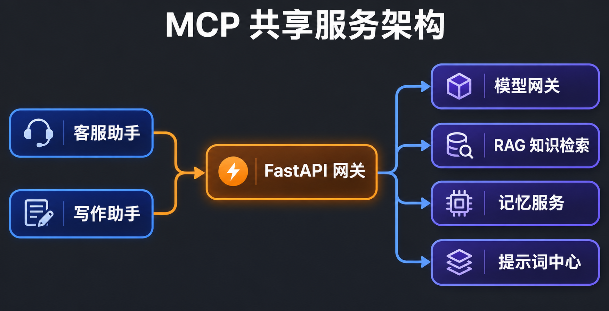
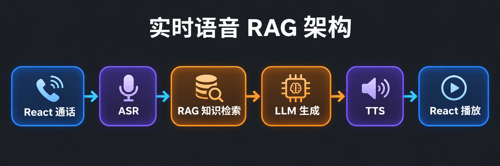

# 庞德锐 · AI 项目作品集

五个公开项目，涵盖售前客服、图文生产、企业 AI 共享服务、语音问答和自媒体运营。每个项目均附架构图和源码。

[AI 商品客服 Agent](#ai-商品客服-agent) · [LangGraph 内容运营助手](#langgraph-内容运营助手) · [MCP 多项目共享服务](#mcp-多项目共享服务) · [实时语音 RAG 客服](#实时语音-rag-客服) · [自媒体内容大脑 Skill](#自媒体内容大脑-skill)

## AI 商品客服 Agent

**项目是什么**　面向售前咨询的客服助手，以课程商品为例，能查询课程资料、匹配学员案例，也能把需要判断的问题交给人工。

**应用场景**　学员问「我零基础，适合哪门课，要学多久？」时，客服需要同时了解课程门槛、周期和类似学员的经历。

**解决的问题**　课程信息在目录里，沟通经验在客服手里。难点是让系统知道该查哪份资料，以及什么时候需要请人确认。

**核心架构**　助手根据问题选择课程目录、学员案例或历史问答，拿到结果后组织回复。遇到难以可靠回答的问题就生成工单，人工补答可以存入话术库。

**实现效果**　客服可以查看一次回答用过哪些工具。遇到相似问题时，助手可以检索之前的人工补答，让工作人员处理过的一次咨询成为可复用的资料。

[查看项目源码](https://github.com/thanhvietp02-dotcom/agent-loop-customer-service-source)

## LangGraph 内容运营助手

**项目是什么**　一套图文内容工作台，把生成选题、写稿、审稿和配图放在同一个流程里。

**应用场景**　运营编辑准备一篇小红书图文，可以先从候选题中选一个方向，收到初稿后给出具体意见，例如「把开头换成新手第一次使用的场景」。

**解决的问题**　一篇稿件往往跨几轮修改。编辑离开页面后，系统需要记住选了什么题、改到哪一版，以及上次为什么退回。

**核心架构**　系统在选题和审稿两处停下来等编辑决定。退稿时，修改意见连同当前稿件一起返回写稿环节；通过后，才提取视觉要点并生成配图。数据库记录每篇稿件的进度。

**实现效果**　编辑可以接着上次的进度修改，也可以把同一篇稿退回重写。配图跟随审定后的内容，避免给已经弃用的草稿生成图片。

[查看项目源码](https://github.com/thanhvietp02-dotcom/langgraph-content-operations-source)

## MCP 多项目共享服务

**项目是什么**　一套供多个 AI 助手共用的后台，把模型调用、知识检索、对话记忆和提示词管理做成四项独立服务。

**应用场景**　同一个团队既有客服助手，也有写作助手。客服要查产品资料，写作助手要查写作规范，两者都要调用模型，并分别统计用量。

**解决的问题**　如果每开发一个助手都重新接模型、做检索、算额度，同一种能力就要维护多份。共用后台的难点，是复用服务的同时还能认清谁在调用、用量该记给谁。

**核心架构**　两个助手都通过同一个网关提交请求。网关识别项目、检查额度，再通过 MCP 将请求交给目标服务；模型返回用量后，网关按项目记录。

**实现效果**　项目中，两个助手可以共用四项服务，同时保留各自的业务流程。新增助手时可以接入已有接口，查询项目用量也有统一入口。

[查看项目源码](https://github.com/thanhvietp02-dotcom/mcp-shared-agent-services-source)

## 实时语音 RAG 客服

**项目是什么**　一套浏览器语音问答系统。用户开口提问，系统查询业务资料，生成回答后用语音播报。

**应用场景**　适合产品使用咨询或知识库语音导览。例如，用户问「这个功能从哪里打开？」，系统可以先查操作说明，再把步骤读出来。

**解决的问题**　语音客服答错时，可能是听错了问题，也可能是资料没找对。要改善回答，需要能分开检查语音识别、知识检索和答案生成。

**核心架构**　浏览器负责收音和播放。云端用 ASR 把语音转成文字，RAG 服务检索知识内容，模型根据资料和对话生成回答，再由 TTS 合成语音。

**实现效果**　系统支持从开麦到播报的完整交互，也提供独立的文本调试入口。维护人员可以先看召回了什么资料，再检查生成的回答，缩小问题排查范围。

[查看项目源码](https://github.com/thanhvietp02-dotcom/realtime-voice-rag-source)

## 自媒体内容大脑 Skill

**项目是什么**　一个帮创作者做选题和复盘的 AI 工具。它把账号定位、对标作品、脚本与发布结果保存在本地内容库里。

**应用场景**　创作者准备下一条短视频时，可以用几个同类账号的数据筛选主题，再结合自己的受众写脚本。发布后，把第 3 天和第 7 天的表现记回同一份记录。

**解决的问题**　不同体量的账号很难只靠点赞数比较。工具会看一条作品相对于该账号平时表现的倍数，再看相似选题是否在多个账号反复出现。

**核心架构**　AI 按固定流程整理数据，分别写入对标库、选题卡、脚本和复盘记录。文件采用普通 Markdown，创作者可以直接查看、修改，下一次对话也能继续读取。

**实现效果**　在仓库的示例数据中，工具把来自 4 个账号的 4 条作品归入「新手入门教程」，并列出判断依据。创作者既能看到推荐方向，也能回头检查支撑它的样本。该数字来自示例数据。

[查看项目源码](https://github.com/thanhvietp02-dotcom/creator-brain)

---

项目来源：商品客服、内容运营助手及 MCP 共享服务基于课程示例，语音客服基于火山引擎 AIGC-RTC Demo。
