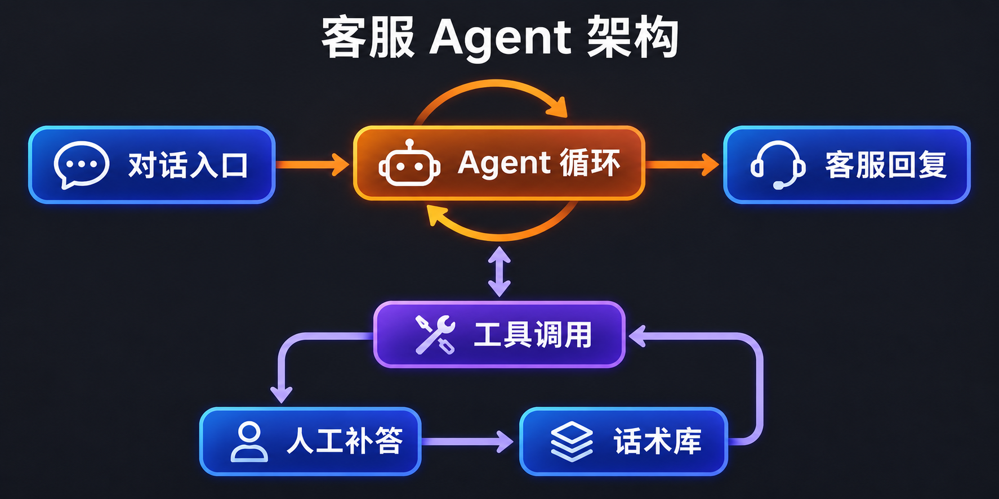

# 庞德锐 · Agent 工程作品集

**从模型怎么调用工具，到业务流程怎么暂停、恢复和交付。**

五个项目覆盖 Agent 运行时、LangGraph 工作流、MCP 共享服务、实时语音 RAG 与自媒体 Skill。每个案例都沿着一次真实的业务动作解释系统的模块边界、数据流和设计取舍。

| 项目 | 看点 | 公开源码 |
| --- | --- | --- |
| [AI 商品客服 Agent](#ai-商品客服-agent) | 模型选工具、工具结果回填、人工补答回流 | [GitHub](https://github.com/thanhvietp02-dotcom/agent-loop-customer-service-source) |
| [LangGraph 内容运营助手](#langgraph-内容运营助手) | 人工选题、审稿退回、检查点恢复 | [GitHub](https://github.com/thanhvietp02-dotcom/langgraph-content-operations-source) |
| [MCP 多项目共享服务](#mcp-多项目共享服务) | 双应用复用工具，网关统一认证、路由和配额 | [GitHub](https://github.com/thanhvietp02-dotcom/mcp-shared-agent-services-source) |
| [实时语音 RAG 客服](#实时语音-rag-客服) | React 通话、RTC 语音链路、独立 RAG 回调 | [GitHub](https://github.com/thanhvietp02-dotcom/realtime-voice-rag-source) |
| [自媒体内容大脑 Skill](#自媒体内容大脑-skill) | 对标数据、选题判断、脚本与发布复盘 | [GitHub](https://github.com/thanhvietp02-dotcom/creator-brain) |

## AI 商品客服 Agent

### 让客服能查工具、能转人工，也能复用上一次补答

以一个反复出现的商品问题为例。第一次遇到时，模型可以先查询现有资料；如果答案不足，就创建人工工单。工作人员补答后，答案写入可检索的话术库。第二次遇到同类问题，Agent 多了一项可用依据。

### 核心链路

运行时用调用 ID 对齐每条工具结果和原始请求。即使同一轮有多个工具调用，返回结果也能被放回正确的位置。回复和执行轨迹一起返回，便于回看模型经过了哪些步骤。

### 设计取舍

扩展商品查询时，可以在工具层添加新的查询能力；调整回答风格时，可以在模型及指令层处理。人工补答是明确的知识写入操作，读取话术与写入话术有各自入口。

**阅读源码**　[Agent 循环](https://github.com/thanhvietp02-dotcom/agent-loop-customer-service-source/blob/main/app/agent/loop.py) · [人工补答服务](https://github.com/thanhvietp02-dotcom/agent-loop-customer-service-source/blob/main/app/services/review_service.py)

## LangGraph 内容运营助手

### 一篇稿件可以等人拍板，也可以带着反馈重写

比如编辑给出一个运营主题。系统先出候选选题，编辑选定其中一个再写稿。初稿如果偏离受众，编辑可以退回并补上修改意见。工作流回到写稿节点，稿件通过审核后才继续提取视觉要点并配图。

### 核心链路

选题本身是可组合的子图。人工选题和人工审稿分别通过 `interrupt()` 暂停；恢复时复用同一个 `thread_id`。审稿节点把审核结果和反馈写入状态，再通过 `Command` 决定接下来去写稿还是去提取视觉要点。

### 设计取舍

审核状态由工作流记录。客户端只需展示等待状态、提交选题或反馈。把图像生成安排在审稿通过之后，可减少为退回稿件做无用配图。

**阅读源码**　[主工作流](https://github.com/thanhvietp02-dotcom/langgraph-content-operations-source/blob/main/app/graph/workflow.py) · [工作流 API](https://github.com/thanhvietp02-dotcom/langgraph-content-operations-source/blob/main/app/api/v1/workflow.py)

## MCP 多项目共享服务

### 两种业务应用复用检索、记忆、提示词和模型服务

客服助手需要从产品知识中找答案，写作助手需要查询写作规范和提示词。它们各自控制交互和业务流程，通过同一套网关调用可复用的能力。

### 核心链路

请求到达 FastAPI 后，网关先识别项目并检查额度。工具路由将请求送到指定 MCP 服务。响应返回模型用量时，网关把用量算到调用项目名下。工具列表、提示词查询和配额查询各有对应接口。

### 设计取舍

应用侧保留简单的 HTTP 接口，网关侧集中维护 MCP 连接。需要增加一个前端或另一类助手时，可以从网关已暴露的能力开始接入。需要看问题出在哪一层，可以分别检查应用请求、网关和目标服务。

**阅读源码**　[网关路由](https://github.com/thanhvietp02-dotcom/mcp-shared-agent-services-source/blob/main/gateway/router.py) · [MCP 连接管理](https://github.com/thanhvietp02-dotcom/mcp-shared-agent-services-source/blob/main/gateway/mcp_client_manager.py)

## 实时语音 RAG 客服

### 把通话接入和知识问答拆开，便于单独调试

用户在浏览器开麦，询问只有业务知识库里才有答案的问题。系统从语音里得到文本，检索相关知识，再把模型生成的回答转换成语音播报。

### 核心链路

React 持有设备和通话状态，RTC 云端完成 ASR 和 TTS。自定义模型回调取最新消息检索知识，将找到的内容与上下文交给 LLM，再通过 SSE 把生成内容交回语音链路。

### 设计取舍

语音能接通与回答是否准确可以分别检查。先用文本调试接口验证知识有没有召回，再检查模型如何使用检索结果，最后接入 RTC 巡检整轮问答。语音链路和知识问答分别有明确的配置入口。

**阅读源码**　[RTC 客户端](https://github.com/thanhvietp02-dotcom/realtime-voice-rag-source/blob/main/src/lib/RtcClient.ts) · [RAG 回调与调试入口](https://github.com/thanhvietp02-dotcom/realtime-voice-rag-source/blob/main/rag_llm_server/main.py)

## 自媒体内容大脑 Skill

### 把一次内容复盘变成下一次选题可以读取的资料

创作者给出对标账号主页或截图，把作品数据整理进本地知识库。下一次挑选题时，Skill 可以回看哪些选题曾被多个账号做出较高的相对表现，并结合自己的账号定位给出脚本方向。

### 核心链路

数据记录用账号自己的日常表现作为比较基准。选题卡关联对标依据，稿件有发布前检查，发布后回填第 3 天和第 7 天的表现。反复出现的规律还可以写进方法论，供之后生成内容时读取。

### 设计取舍

把知识保存在 Markdown 文件和目录里，创作者能直接阅读和修订这些内容。换一个会话时，可以让支持 Skill 的助手重新读取账号资料、历史稿件和复盘结果。

**阅读源码**　[Skill 源码与安装说明](https://github.com/thanhvietp02-dotcom/creator-brain) · [示例数据](https://github.com/thanhvietp02-dotcom/creator-brain/tree/main/examples)

---

本页用于技术面试交流，展示项目架构与实现。前三项基于课程示例，实时语音项目基于火山引擎 AIGC-RTC Demo。五个项目的公开源码链接见上方列表。
