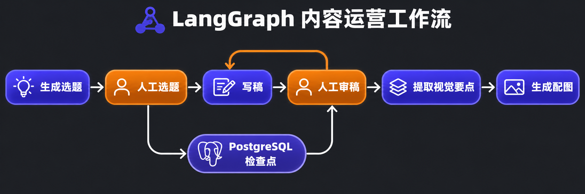
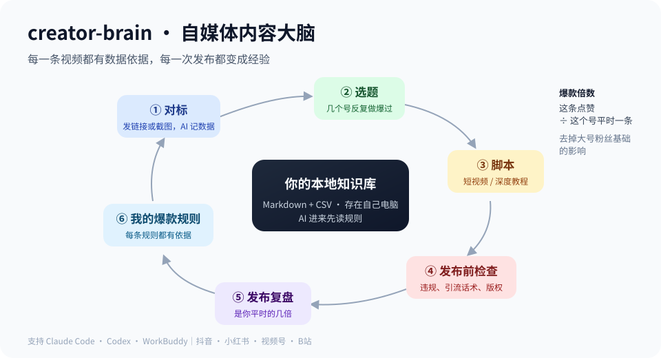

# 庞德锐 · Agent 工程作品集

**从模型怎么调用工具，到业务流程怎么暂停、恢复和交付。**

五个项目覆盖 Agent 运行时、LangGraph 工作流、MCP 共享服务、实时语音 RAG 与自媒体 Skill。每个案例都沿着一次真实的业务动作解释系统的模块边界、数据流和设计取舍。

| 项目 | 看点 | 公开源码 |
| --- | --- | --- |
| [AI 商品客服 Agent](#ai-商品客服-agent) | 模型选工具、工具结果回填、人工补答回流 | [GitHub](https://github.com/thanhvietp02-dotcom/agent-loop-customer-service-source) |
| [LangGraph 内容运营助手](#langgraph-内容运营助手) | 人工选题、审稿退回、检查点恢复 | [GitHub](https://github.com/thanhvietp02-dotcom/langgraph-content-operations-source) |
| [MCP 多项目共享服务](#mcp-多项目共享服务) | 双应用复用工具，网关统一认证、路由和配额 | [GitHub](https://github.com/thanhvietp02-dotcom/mcp-shared-agent-services-source) |
| [实时语音 RAG 客服](#实时语音-rag-客服) | React 通话、RTC 语音链路、独立 RAG 回调 | [GitHub](https://github.com/thanhvietp02-dotcom/realtime-voice-rag-source) |
| [自媒体内容大脑 Skill](#自媒体内容大脑-skill) | 对标数据、选题判断、脚本与发布复盘 | [GitHub](https://github.com/thanhvietp02-dotcom/creator-brain) |

## AI 商品客服 Agent

### 让客服能查工具、能转人工，也能复用上一次补答

以一个反复出现的商品问题为例。第一次遇到时，模型可以先查询现有资料；如果答案不足，就创建人工工单。工作人员补答后，答案写入可检索的话术库。第二次遇到同类问题，Agent 多了一项可用依据。

### 核心链路

运行时用调用 ID 对齐每条工具结果和原始请求。即使同一轮有多个工具调用，返回结果也能被放回正确的位置。回复和执行轨迹一起返回，便于回看模型经过了哪些步骤。

### 设计取舍

扩展商品查询时，可以在工具层添加新的查询能力；调整回答风格时，可以在模型及指令层处理。人工补答是明确的知识写入操作，读取话术与写入话术有各自入口。

### 为什么要做这套客服流程

商品咨询的难点是答案的来源不同。标准问题可能在课程资料里，沟通问题可能有现成话术，也有问题必须由工作人员确认。把这些内容全部塞进模型上下文，后续很难回答“这句话从哪里来”和“为什么这里需要转人工”。项目将这三类动作拆成可调用工具，让模型负责挑工具，由代码负责取数据、记录结果和创建工单。

### 从请求到回答，发生了什么

1. 浏览器向 FastAPI 聊天入口发送会话标识和问题。对话服务准备上下文并选择模型提供方。
2. 模型返回要调用的工具及参数。循环执行相应工具，将调用 ID、工具名称和结果保留在记录中，再把结果送回模型。
3. 模型获得工具结果后可以开始回答，也可以继续查询。循环步数有明确上限，界面可以查看执行轨迹。
4. 如果进入人工分支，系统创建工单。人工补答进入话术库，后续会话可以主动检索。补答因此可以服务其他会话，也可以在话术管理入口维护。

### 面试时可以重点讲的细节

| 设计点 | 背后的问题 |
| --- | --- |
| 调用 ID 和结果成对记录 | 一轮有多个调用时，怎样知道哪项数据属于哪个工具 |
| 工具返回后再决策 | 什么情况下还需要继续查，什么情况下已有信息足以回答 |
| 工单和话术更新分开 | 如何把当前问题交给人，同时积累以后能用的数据 |
| Mock 与 ARK 提供方 | 如何分别检查控制流和真实模型接入 |

本仓库展示的是可追踪的工具循环和人工补答链路。查看线上回答质量时，需要用真实模型配置和有代表性的问答数据另做验证。

**阅读源码**　[Agent 循环](https://github.com/thanhvietp02-dotcom/agent-loop-customer-service-source/blob/main/app/agent/loop.py) · [人工补答服务](https://github.com/thanhvietp02-dotcom/agent-loop-customer-service-source/blob/main/app/services/review_service.py)

## LangGraph 内容运营助手

### 一篇稿件可以等人拍板，也可以带着反馈重写

比如编辑给出一个运营主题。系统先出候选选题，编辑选定其中一个再写稿。初稿如果偏离受众，编辑可以退回并补上修改意见。工作流回到写稿节点，稿件通过审核后才继续提取视觉要点并配图。

### 核心链路

选题本身是可组合的子图。人工选题和人工审稿分别通过 `interrupt()` 暂停；恢复时复用同一个 `thread_id`。审稿节点把审核结果和反馈写入状态，再通过 `Command` 决定接下来去写稿还是去提取视觉要点。

### 设计取舍

审核状态由工作流记录。客户端只需展示等待状态、提交选题或反馈。把图像生成安排在审稿通过之后，可减少为退回稿件做无用配图。

### 为什么把人工审核写进图

内容生产的任务状态横跨多次交互。选题还没确认，写出来的稿件容易偏离方向；初稿被退回后，下一次生成还需要拿到原题和修改意见。这个项目将编辑介入点和返工路径直接建模，前端在不同时间提交决定，后端沿着同一线程继续执行。

### 从候选题到可用稿件

1. 选题子图产生候选主题，在选择节点暂停。编辑输入选择后，主工作流拿到选题继续写稿。
2. 草稿写完进入人工审稿。审核可以通过，也可以附意见退回。
3. 退回时，反馈和审核状态一同记录，执行跳回写稿。通过时才进入视觉要点提取与图片生成。
4. PostgreSQL 保存检查点。前端可以按线程查询状态或历史，再从暂停点提交输入。仓库同时提供普通恢复和流式恢复入口。

### 最值得看的一条分支

沿着「审稿退回 → 写稿 → 再次审稿」读代码。先看状态定义里稿件和反馈如何表达，再看审稿节点通过 `Command` 更新状态并决定下一节点，最后看 API 如何把线程标识传给工作流。三个位置一起解释了用户动作如何变成状态变化。

| 层 | 负责什么 |
| --- | --- |
| Vue 前端 | 呈现候选项、稿件和当前待处理动作 |
| FastAPI | 建立线程、查询状态、提交编辑决定 |
| LangGraph | 管理节点、人工中断和审核后的跳转 |
| PostgreSQL | 保存检查点供后续请求恢复 |

**阅读源码**　[主工作流](https://github.com/thanhvietp02-dotcom/langgraph-content-operations-source/blob/main/app/graph/workflow.py) · [工作流 API](https://github.com/thanhvietp02-dotcom/langgraph-content-operations-source/blob/main/app/api/v1/workflow.py)

## MCP 多项目共享服务

### 两种业务应用复用检索、记忆、提示词和模型服务

客服助手需要从产品知识中找答案，写作助手需要查询写作规范和提示词。它们各自控制交互和业务流程，通过同一套网关调用可复用的能力。

### 核心链路

请求到达 FastAPI 后，网关先识别项目并检查额度。工具路由将请求送到指定 MCP 服务。响应返回模型用量时，网关把用量算到调用项目名下。工具列表、提示词查询和配额查询各有对应接口。

### 设计取舍

应用侧保留简单的 HTTP 接口，网关侧集中维护 MCP 连接。需要增加一个前端或另一类助手时，可以从网关已暴露的能力开始接入。需要看问题出在哪一层，可以分别检查应用请求、网关和目标服务。

### 为什么把共享能力做成独立服务

客服助手与写作助手面对不同用户，提示词、知识来源和交互流程也不同；它们都需要检索、记忆、提示词模板和模型请求。项目把这几类能力放在共享服务里，应用通过统一网关访问。读代码时，可以用“增加第三种助手是否要重写一套连接逻辑”检验服务边界。

### 一次工具请求经过哪几层

1. 应用侧的网关客户端构造请求，并携带可用于识别项目的信息。
2. FastAPI 中间件校验项目身份并检查额度。业务路由把工具请求交给 MCP 连接管理器。
3. 目标服务执行工具并返回结果。如果模型调用返回 token 用量，网关将其计入对应项目。
4. 应用拿到结果后再进行自己的回复或写作处理。知识内容、会话记忆和生成的文案分别由相应模块处理。

### 网关和共享能力的责任边界

| 组件 | 职责 |
| --- | --- |
| FastAPI 网关 | 统一接入、项目识别、配额检查、工具路由 |
| 模型网关 | 封装模型调用，回传可用于记账的用量 |
| RAG 服务 | 文档接入和知识检索 |
| 记忆服务 | 读写会话记忆 |
| 提示词中心 | 管理并提供可供应用调用的模板 |

可以先跟读网关路由，再读连接管理器和某个 MCP 服务的注册代码。项目附带网关和各服务检查脚本，便于分别看请求有没有到网关、有没有进入目标工具、返回值是否符合预期。

**阅读源码**　[网关路由](https://github.com/thanhvietp02-dotcom/mcp-shared-agent-services-source/blob/main/gateway/router.py) · [MCP 连接管理](https://github.com/thanhvietp02-dotcom/mcp-shared-agent-services-source/blob/main/gateway/mcp_client_manager.py)

## 实时语音 RAG 客服

### 把通话接入和知识问答拆开，便于单独调试

用户在浏览器开麦，询问只有业务知识库里才有答案的问题。系统从语音里得到文本，检索相关知识，再把模型生成的回答转换成语音播报。

### 核心链路

React 持有设备和通话状态，RTC 云端完成 ASR 和 TTS。自定义模型回调取最新消息检索知识，将找到的内容与上下文交给 LLM，再通过 SSE 把生成内容交回语音链路。

### 设计取舍

语音能接通与回答是否准确可以分别检查。先用文本调试接口验证知识有没有召回，再检查模型如何使用检索结果，最后接入 RTC 巡检整轮问答。语音链路和知识问答分别有明确的配置入口。

### 为什么把语音和知识问答拆开

语音客服有两类不同的问题：一类是设备、会话、音频传输和播报；另一类是用户实际问了什么、知识库找到了什么、模型是否用到了这些内容。拆成两条链路后，浏览器接通和知识答案的正确性可以分别排查。

### 从麦克风到播报的数据流

1. React 管理录音设备与通话状态，场景接入服务为 RTC 会话提供所需配置。
2. RTC 的 ASR 将音频识别成文本，通过自定义模型回调交给后端。
3. RAG 模块使用最新一条消息检索知识内容。LLM 生成服务同时接收对话消息和检索结果。
4. 后端通过 SSE 返回生成结果。RTC 侧把文本交给 TTS，合成的音频由浏览器播放。

### 如果一轮回答出现问题，先看哪里

| 现象 | 优先定位 |
| --- | --- |
| 麦克风不可用或没有声音 | React 设备状态、RTC 进房与音频事件 |
| 能转成文字，但答非所问 | 用 `/debug/rag` 单独核对召回的知识内容 |
| 知识命中，但回答仍缺信息 | 用 `/debug/chat` 检查文本检索与生成的衔接 |
| 文本生成正常，语音没有播报 | 检查回调的 SSE 输出及 RTC 的语音侧配置 |

仓库保留了 [火山引擎上游许可](https://github.com/thanhvietp02-dotcom/realtime-voice-rag-source/blob/main/LICENSE)。完整通话需要开通并配置相应云服务。语音图呈现主链路，场景控制和文本调试接口可以沿源码入口查看。

**阅读源码**　[RTC 客户端](https://github.com/thanhvietp02-dotcom/realtime-voice-rag-source/blob/main/src/lib/RtcClient.ts) · [RAG 回调与调试入口](https://github.com/thanhvietp02-dotcom/realtime-voice-rag-source/blob/main/rag_llm_server/main.py)

## 自媒体内容大脑 Skill

### 把一次内容复盘变成下一次选题可以读取的资料

创作者给出对标账号主页或截图，把作品数据整理进本地知识库。下一次挑选题时，Skill 可以回看哪些选题曾被多个账号做出较高的相对表现，并结合自己的账号定位给出脚本方向。

### 核心链路

数据记录用账号自己的日常表现作为比较基准。选题卡关联对标依据，稿件有发布前检查，发布后回填第 3 天和第 7 天的表现。反复出现的规律还可以写进方法论，供之后生成内容时读取。

### 设计取舍

把知识保存在 Markdown 文件和目录里，创作者能直接阅读和修订这些内容。换一个会话时，可以让支持 Skill 的助手重新读取账号资料、历史稿件和复盘结果。

### 它在解决什么问题

做内容时，看对标、选题、写稿和复盘经常发生在不同对话里。创作者容易记得哪条爆过，却找不到当时的样本、选题判断和发布结果。这个 Skill 用本地文件把这些材料串起来，让下一次选题能查回上一次留下的证据。

### 以一条短视频为例

1. **记录对标**。输入对标账号主页或截图，提取可用数据，建立账号卡和内容记录。
2. **判断选题**。用作品表现相对账号日常水平的倍数观察异常，再看同类选题是否在多个账号出现。依赖这些记录给选题卡补上依据。
3. **生产与检查**。基于账号定位和选题卡准备脚本。发布前检查夸张表述、平台标注和素材相关风险。
4. **回填与复盘**。记录第 3 天和第 7 天表现，回顾当时的判断。复盘形成的方法论可以在下一轮选题或写稿时重新读取。

### 文件组织如何帮助 Agent 工作

定位资料提供账号和受众上下文，对标库保存外部观察，选题池记录题目的依据，内容生产目录保存草稿，发布与复盘目录记录结果，方法论目录存放可反复引用的规则。这些文件可以逐项检查和修订，也可以在新的对话里重新加载。

| 信息 | 后续怎么用 |
| --- | --- |
| 对标作品与账号基线 | 判断异常表现是否来自选题，避免只看绝对数字 |
| 选题卡与历史稿件 | 保留当时为什么做这个题、脚本怎么写 |
| 发布结果与复盘规律 | 用结果校对判断，把重复出现的经验留给下一轮 |

仓库中的示例数据用于说明流程和判断方法。Skill 支持 Claude Code、Codex 和 WorkBuddy，实际输入质量取决于创作者提供的材料。

**阅读源码**　[Skill 源码与安装说明](https://github.com/thanhvietp02-dotcom/creator-brain) · [示例数据](https://github.com/thanhvietp02-dotcom/creator-brain/tree/main/examples)

---

本页用于技术面试交流，展示项目架构与实现。前三项基于课程示例，实时语音项目基于火山引擎 AIGC-RTC Demo。五个项目的公开源码链接见上方列表。
