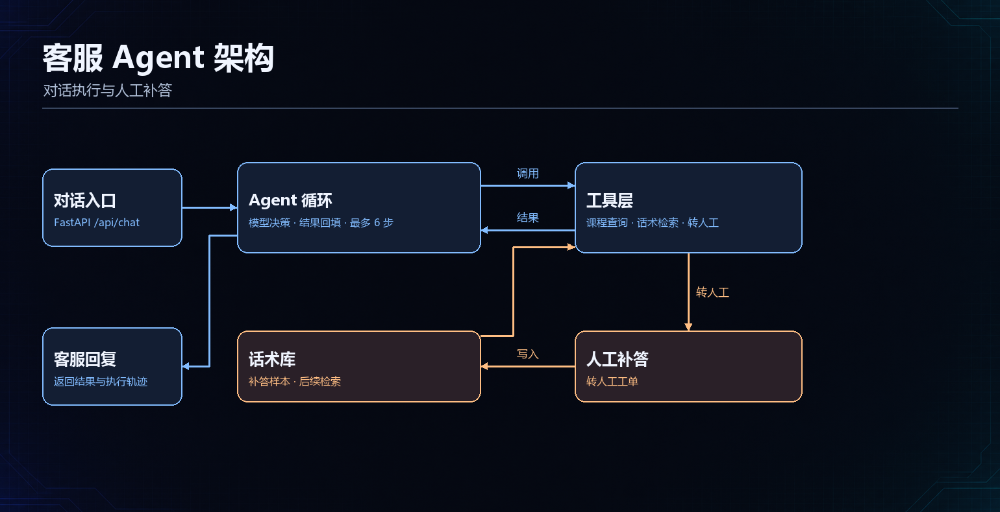
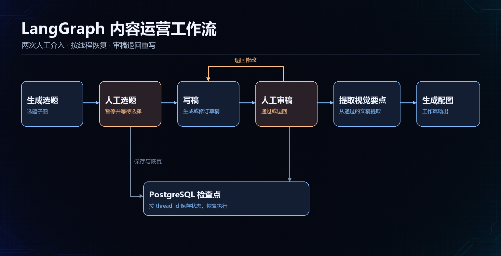
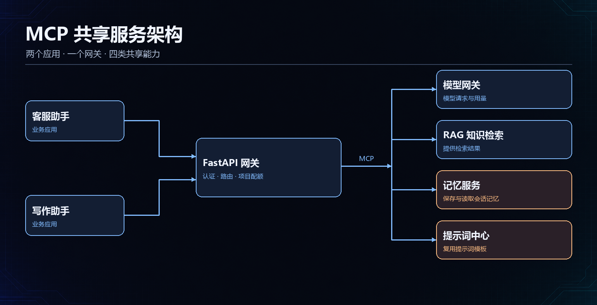
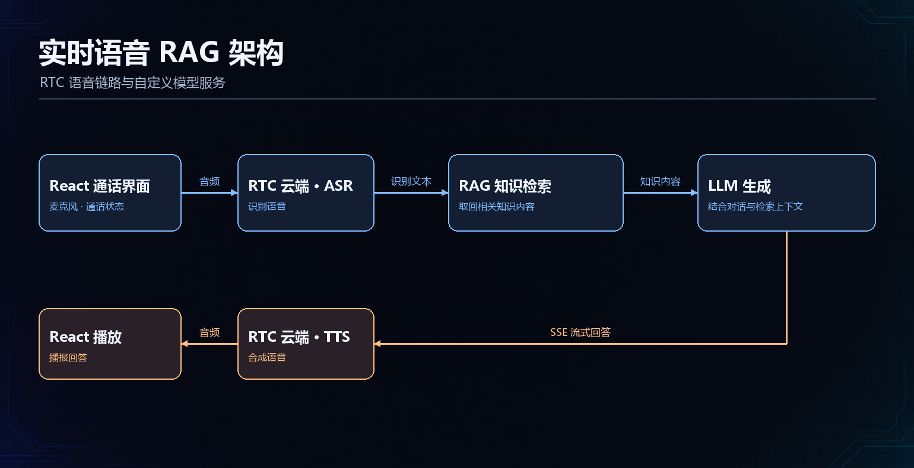

# 庞德锐 · Agent 工程作品集

**从模型怎么调用工具，到业务流程怎么暂停、恢复和交付。**

四个项目覆盖 Agent 运行时、LangGraph 工作流、MCP 共享服务和实时语音 RAG。每个案例都沿着一次真实的业务动作解释系统的模块边界、数据流和设计取舍。

| 项目 | 看点 |
| --- | --- |
| [AI 商品客服 Agent](#ai-商品客服-agent) | 模型选工具、工具结果回填、人工补答回流 |
| [LangGraph 内容运营助手](#langgraph-内容运营助手) | 人工选题、审稿退回、检查点恢复 |
| [MCP 多项目共享服务](#mcp-多项目共享服务) | 双应用复用工具，网关统一认证、路由和配额 |
| [实时语音 RAG 客服](#实时语音-rag-客服) | React 通话、RTC 语音链路、独立 RAG 回调 |

## AI 商品客服 Agent

商品咨询里，有些问题能查到标准答案，有些需要人工确认。这个项目把处理过程拆为工具执行、人工工单和话术回流，方便解释一条回答是怎样得出的。

- **一次请求如何完成**。FastAPI 接收问题，对话服务准备上下文。模型发出工具调用后，运行时按调用 ID 回填结果，再交给模型决定继续调用或回复。执行轨迹随结果返回。
- **问题答不上来时**。转人工工具创建工单。人工提交补答后，问答样本进入话术库。下次遇到相似问题，可以通过话术检索获取答案。
- **关键取舍**。单次对话最多循环六步。知识新增由显式补答触发。默认用 Mock 模型复现分支，也提供 ARK 模型接入。

## LangGraph 内容运营助手

编辑会在选题和审稿时改变工作流方向。项目把这两个决定写进状态图，让前端可以在任意一次请求之后继续处理同一篇稿件。

- **从选题到稿件**。选题子图生成候选主题后，通过 `interrupt()` 等待编辑选择。确认后才进入写稿。
- **退回怎么走**。审稿退回时，反馈写入线程状态，`Command` 把执行路由回写稿；审核通过才提取视觉要点并生成配图。
- **恢复怎么做**。API 用 `thread_id` 将编辑操作关联到同一次工作流，PostgreSQL 检查点保存状态。前端可以查询当前节点并提交输入继续执行。

## MCP 多项目共享服务

客服和写作助手的业务逻辑各自独立，但都需要模型、知识检索、记忆和提示词。项目用一个 HTTP 网关把两个应用接到四类 MCP 服务。

- **一次调用怎么走**。应用发起 HTTP 请求，网关识别项目、检查配额，再通过连接管理器调用对应的 MCP 工具。模型返回用量时，网关按项目记账。
- **什么放在网关**。项目身份、额度检查、工具路由和用量查询集中在 FastAPI。RAG、记忆和提示词的具体实现归各自服务维护。
- **为什么这样拆**。增加一个业务应用时，可以沿用现有网关接口。更换某项共享能力的内部实现时，应用侧可以继续沿用同一个调用入口。

## 实时语音 RAG 客服

用户在浏览器开麦提问，系统实时播报结合业务知识生成的答案。架构把语音交互与知识问答拆开，便于分别调整和排查。

- **语音怎么进来**。React 管理设备和通话状态，场景服务处理会话接入，RTC 云端完成 ASR 并调用自定义模型接口。
- **答案怎么生成**。RAG 服务取最新一条消息检索知识内容，将结果与会话消息一起交给 LLM。生成结果通过 SSE 返回，再经 TTS 合成语音。
- **怎么定位问题**。检索与模型生成分开实现，可用文本调试接口分别检查召回内容和生成结果。完整通话依赖 RTC、ASR、TTS、模型和知识库服务配置。

---

本页用于技术面试交流，展示项目架构与实现。前三项基于课程示例，实时语音项目基于火山引擎 AIGC-RTC Demo。源码在私有仓库，可在技术面按需提供。
